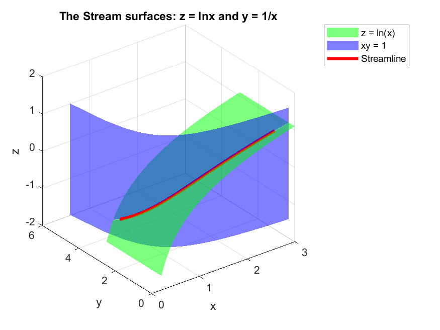
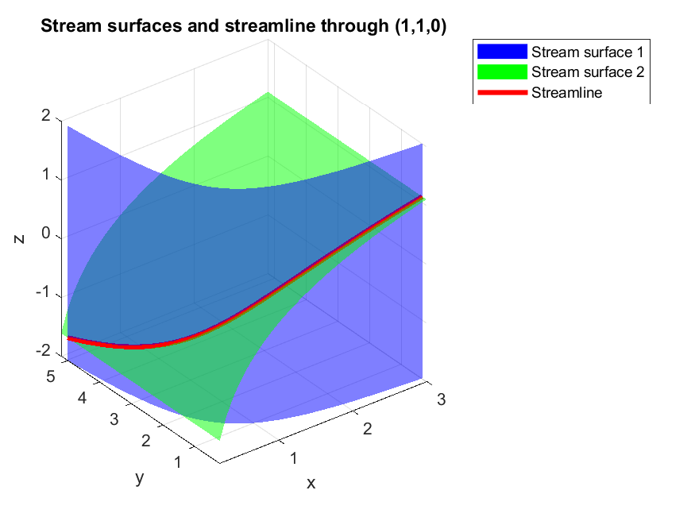

# Stream surfaces and streamline

Given a 3D steady velocity field and a seed point, this project finds the two stream surfaces that pass through the point and shows the streamline as the curve where they intersect.

It is built in three parts. Each part solves the same problem differently, and each one ends at a limitation that the next part is designed to address.

Parts 1 and 2 were completed on 13 and 14 October 2026, respectively, and published to GitHub on 18 and 19 October 2026.

## The problem

A streamline is a curve that is tangent to the velocity vector at every point. We know from vector algebra that the cross product of two parallel vectors is zero. If a vector is tangent to another vector at every point, they are parallel at every point. Mathematically, `V × ds = 0`, where 

```
V = iu + jv + kw

ds = idx + jdy + kdz. 
```

The cross product will have the components 

```
vdz - wdy = 0
  
wdx - udz = 0

udy - vdx = 0. 
```

From the components, we see that 

```
dx/u = dy/v = dz/w. 
```

Only two of the three equations in this chain are independent. Integrating the two of them gives two families of surfaces, `f1(x,y,z) = c1` and `f2(x,y,z) = c2`, called stream surfaces. No flow crosses a stream surface, so a seed point fixes the constants `c1` and `c2`, which pick one surface from each family, and the streamline is where those two surfaces meet.

## Test flow used in every part

```
u = x, v = -y, w = 1       seed point: (1, 1, 0)
```

Here, when we substitute the values of u, v, and w into the ratio relations, each ratio involves a single variable, so the integral can be done easily by hand. The result, worked out on paper, is:

| Quantity | Result |
| --- | --- |
| First stream surface | `xy = 1` (equivalent to `ln(xy) = 0`) |
| Second stream surface | `z = ln(x)` (equivalent to `z - ln(x) = 0`) |
| Streamline | `x = e^t, y = e^(-t), z = t` (`S` was parametrised with `t`)|

Using the same flow in all three parts means the three methods can be compared on the same picture.

## Parts

| Part | Approach | Status |
| --- | --- | --- |
| [1](part1-manual-integration/) | Manual integration: derive the surfaces on paper, then plot them in MATLAB | Done (13 Oct 2026) |
| [2](part2-symbolic-math-method/) | Symbolic integration: MATLAB finds the surfaces from u,v,w | Done (14 Oct 2026) |
| 3 | Numerical integration: `ode45` traces the streamline directly | In progress |

### Part 1: Manual integration

I integrated the ratios by hand, rearranged each surface equation so that one variable is written in terms of the other two (`y = 1/x` and `z = ln x`), and plotted them with `meshgrid`, `surf`, and `plot3` functions.



#### Limitation

Every step of the algebra is mine. A new velocity field means a new integration, and plotting with surf requires each surface to be solved explicitly for one variable, which is not always possible.

### Part 2: Symbolic integration

The Symbolic Math Toolbox does the integration (```int```), finds the constants from the seed point (```subs```), and plots the surfaces implicitly (```fimplicit3```). Two checks are built in to ensure a stream surface is truly a stream surface, and the streamline is the curve formed by the intersection of the two stream surfaces:

- **Gradient test:** `V · ∇f = 0` everywhere shows that each `f` really is a stream surface. Both tests return exactly 0 because the symbolic algebra cancels exactly.
- **Residual test**: The hand-derived streamline is substituted into both surface equations. The largest residual is about 2.2e-16, which is the machine precision (`eps`), so the curve lies on both surfaces to rounding error.



#### Limitation
The method only works when each integral involves a single variable, so most real velocity fields break it. The streamline is still parametrised by hand. Dividing `u`, `v`, or `w` also fails wherever they are zero.

## Part 3: Numerical integration (in progress)
Setting the common value of the three ratios to `dr` gives

```
dx/dr = u, dy/dr = v, dz/dr = w
```

which has no division, so zero velocity components are no longer a problem. `ode45` integrates this system from the seed point and builds the streamline step by step for any velocity field. The plan is to overlay the numerical curve on the Part 2 surfaces and compare it with the hand-derived streamline.

## Running the scripts
- Requires MATLAB (written in R2021a). Part 2 also requires the Symbolic Math Toolbox.
- Run each script from its own folder. The scripts save their figure to MATLAB's current folder, so running them from somewhere else may give a "cannot create output file" error or put the image in the wrong place.

## Files


```
stream-surfaces/
├── README.md
├── part1-manual-integration/
│   ├── README.md
│   ├── stream_surfaces_part1.m
│   └── stream_surfaces_part1.png
├── part2-symbolic-integration/
│   ├── README.md
│   ├── stream_surfaces_using_symbolic_math_method.m
│   └── Stream_surfaces_using_symbolic_method.png
└── part3-numerical-integration/      (to be added)
```

## What I learned
- Why a surface equation with a missing variable is an extrusion (a cylinder) along that variable's axis.
- Why `meshgrid` is needed when two variables are independent.
- The difference between an expression and its constant: `f1` is a function of x, y, z, and `c1` is the number found at the seed point.
- Why one test returns exactly 0 and another about 1e-16 (symbolic versus floating-point arithmetic).
