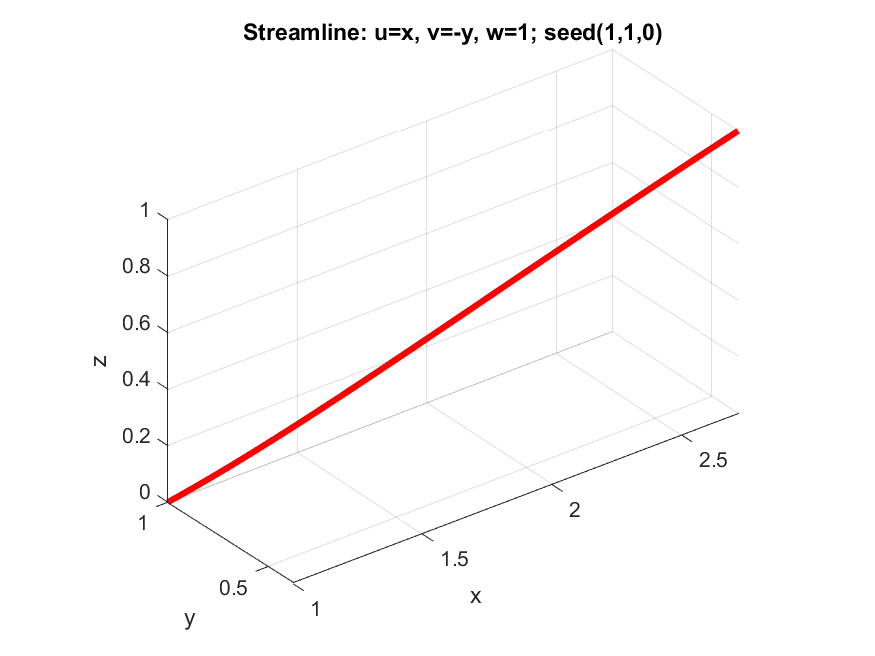
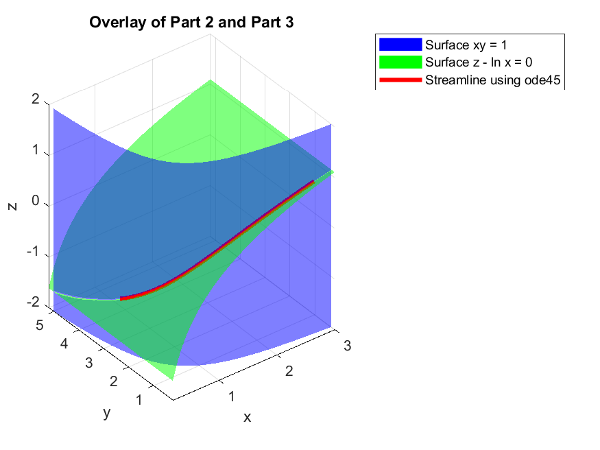
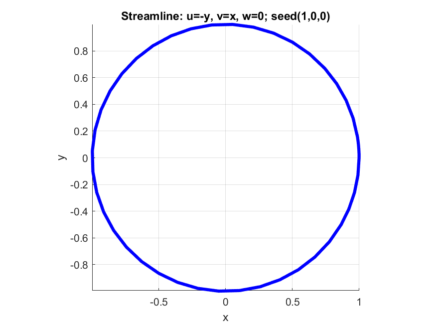

# Part 3: Numerical Integration

[Part 1](../part1-manual-integration/) needed me to integrate by hand, and [Part 2](../part2-symbolic-integration/) needed the integrals to separate into one-variable pieces and could not divide by a zero velocity component. In this part, MATLAB's `ode45` traces the streamline directly from the velocity field and a seed point. There are no integrals to solve and no division.

Completed: 23 October 2026.

## The idea

Set the common value of the three ratios in `dx/u = dy/v = dz/w` to `dτ`. Solving each ratio for its differential gives

``` math
dx/dτ = u,   dy/dτ = v,   dz/dτ = w
```
or, in vector form with `p = (x, y, z)`,
``` math
dp/dτ = V(p)
```
- **No division.** If a velocity component is zero, its equation says that coordinate is not changing, which is true. It does not blow up.
- **An initial value problem.** Given the starting position (the seed point) and the velocity field `V`, finding `p(τ)` is exactly what `ode45` solves.
- **What τ is.** A bookkeeping parameter. In a steady flow, it can be read as time, and the curve is the path of a fluid particle released at the seed, which coincides with the streamline. For an unsteady flow, the two differ, and a streamline needs time frozen at one instant. This script handles steady flows only.

## How the script uses `ode45`
`streamline_using_ode45.m` needs three things for each flow:
``` matlab
seed = [1; 1; 0];                   %starting position, as a column
rhs1 = @(t, p) [p(1), -p(2); 1];    %velocity at position p, as a column
[T1, P1] = ode45(rhs1, [0 1], seed) %integrate from t = 0 to t = 1
```
- `ode45` always calls `rhs1` with the parameter first and the position second, so the function takes both inputs even though a steady flow does not use `t`.
- The function must return a **column**, and the starting position must be a column.
- `P1` has one row per step. Its columns are x,y, and z, so the curve is `plot3(P1(:,1), P1(:,2), P1(:,3))`.
- `ode45` chooses its own step sizes, so `T1` is not evenly spaced.
- A streamline runs both ways from the seed, so a second run with `[0 -1]` gives the backward half, and the two are joined with `flipud`.

## Test flow 1: checked against an exact answer

```
u = x,    v = -y,    w = 1                         seed point: (1, 1, 0)
```
This is the test flow from Parts 1 and 2, which has the exact solution `x = e^t, y = e^(-t), z = t`. At `t = 1` the exact position is (e, 1/e, 1), and `ode45` returned

```
2.718281834233623     0.367879442271613     1.000000000000000
```

The errors are about 5.8e-9 in x, 1.1e-9 in y, and about 1e-16 in z. The z error is machine precision, because `dz/dt = 1` does not depend on position, so the solver adds it up exactly.



### Overlay on the Part 2 surfaces

The two stream surfaces from Part 2 (`xy = 1` and `z = ln x`) are drawn with `fimplicit3`, using function handles so that all three variables are inputs. The numerical streamline, run forward and backward from the seed, is drawn on top. It lies along the intersection of the two surfaces.



The residual test from Part 2 (substituting the curve into both stream surface equations) comes out at about 5.115e-9 and 6.358e-9 on the forward and backward curves joined together, the same size as the solver's error. That is much larger than the 2.2e-16 from the hand-derived curve in Part 2, because that curve was exact and this one is numerical.

## Test flow 2: a flow Part 2 cannot solve

```
u = -y,   v = x,   w = 0        seed point: (1, 0, 0)
```

Part 2 integrates `dz/w` which divides by zero here. The parametric form just gives `dz/dτ = 0`, so z stays at 0.

By hand, `dx/(-y) = dy/x` gives 
`x² + y² = c` and the seed fixes `c = 1`. The streamline is the unit circle at z = 0, traversed counterclockwise, and `x = cos t, y = sin t` completes one loop at `t = 2π`.



The figure uses `view(2)`, a top-down view, and `axis equal`. Without equal axes, MATLAB stretches one axis and the circle looks like an ellipse.

After one full lap (`tspan = [0 2*pi]`), the solution is close to the start but not on it: the radius is 0.99991, about 9e-5 short of 1, and the point has moved slightly past its starting angle. The radius error means the numerical curve has drifted very slightly off the surface 
`x² + y² = 1.`

## Running it

- Requires MATLAB (written in R2021a). No toolboxes are needed.
- Run the script from its own folder. It saves its figures with `saveas` into MATLAB's current folder, so running it from elsewhere can give a "cannot create output file" error.

## Files

```
part3-numerical-integration/
├── README.md
├── streamline_using_ode45.m
├── streamline_using_ode45_flow1.png
├── streamline_using_ode45_flow2.png
└── overlay_part2_part3.png
```

## Limitation

- **Not yet a general tool**. The velocity function and the time span are typed in by hand for each flow. No algebra is needed, but I cannot yet enter `u`, `v`, `w` and a seed and get a result in one step.
- **The result is a list of points**. There is no formula and no surface, so the stream-surface picture of Parts 1 and 2 is lost unless the surfaces are known separately, as in the overlay.
- **Accuracy depends on solver settings, and I have not yet understood it well**. Flow 1 was accurate to about 1e-9, but flow 2 drifted by about 1e-4 in one lap with the default tolerances. I have not yet studied how this error grows or how tightening the tolerances changes it, and I plan to return to it.
- **The time span is chosen by hand**. The solver does not know about the plotting box, so the curve covers only the range of `t` I give it.
- **Steady flows only**. An unsteady flow would need time frozen at one instant to get a streamline, which the script does not do.
- **Stagnation points**. Where `u = v = w = 0`, the particle stops, and no method can continue a streamline from there.
